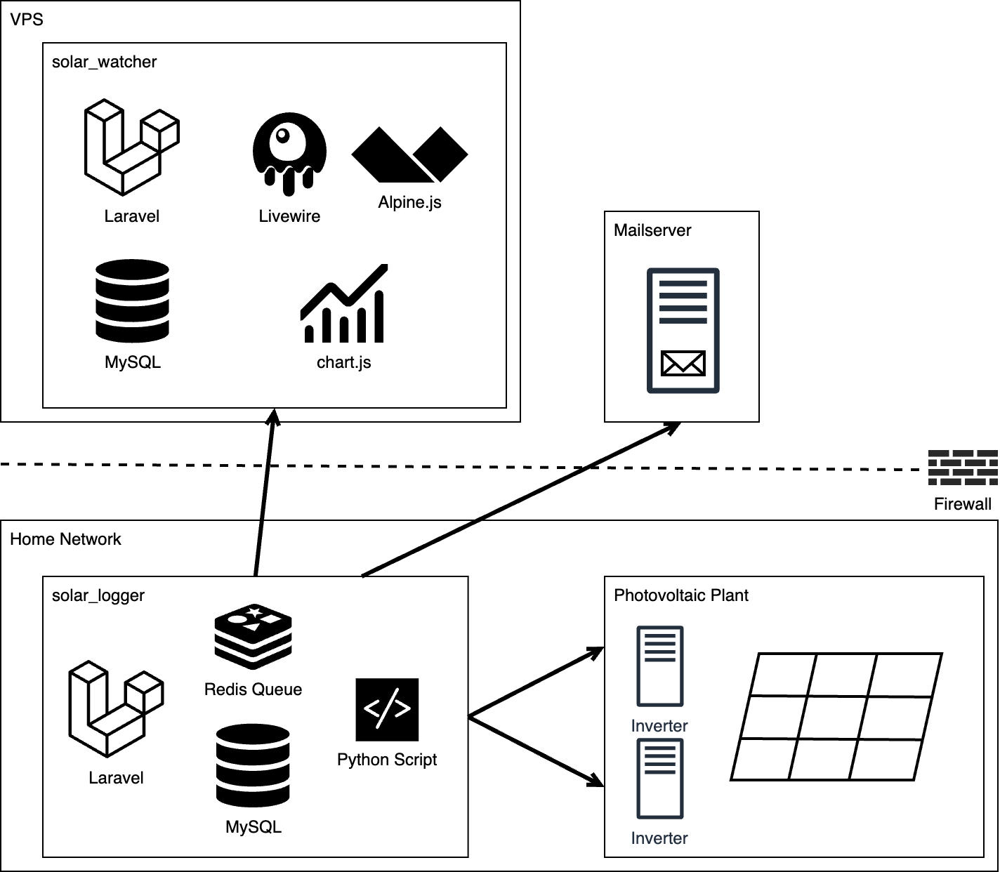

# Solar Logger



**Solar Logger** is a specialized backend application built with Laravel, designed to continuously collect, process, and securely transmit data from a private solar energy system to an external monitoring application.

## Core Functionalities

- **Automated Data Retrieval**: Regular acquisition of current solar data through proprietary inverter APIs using a custom-developed Python script.
- **Data Integration & Local Storage**: Laravel-based backend analyzes and stores retrieved data in a local MySQL database.
- **Secure Data Transfer**: An export module synchronizes data via a REST API interface with an external Laravel application ([solar_watcher](https://github.com/TobMoeller/solar_watcher)).
- **Queue Management**: A Redis powered Laravel Queue is employed for efficient handling of export jobs, ensuring reliable and performant synchronization.
- **Automatic Notifications**: Email alert system notifying about outages or communication issues with individual inverters.

## Development

The project targets Laravel 13, PHP 8.5.12 or newer within 8.5, and Node.js 24. `flake.nix` and
`flake.lock` provide a reproducible Nix development shell for x86_64 Linux and
64-bit ARM Linux (including compatible Raspberry Pis). Commit both files; update
the pinned packages deliberately with `nix flake update`.

With Nix flakes enabled, run:

```sh
nix develop
composer install
cp .env.example .env # first setup only; preserve an existing .env
php artisan key:generate # first setup only
npm ci
php artisan test --fail-on-warning --fail-on-deprecation
vendor/bin/phpstan analyse --memory-limit=1G
npm run build
```

The shell includes PHP with Redis, PDO MySQL/SQLite and ZIP support, Composer,
Node/npm, Python 3, MariaDB client tools, Redis and Samba's `smbclient`. It does
not start database or Redis services. Tests use in-memory SQLite and fake external
HTTP requests; running the logger needs your own MySQL/Redis configuration.
Keep monitoring, exports and notifications disabled in a development environment
until their endpoints are configured. The inverter command invokes `python`,
which the shell provides as Python 3.

Commands also work without entering an interactive shell, for example
`nix develop -c php artisan test`. Without Nix, install PHP 8.5.12 or newer within 8.5 and its required
extensions, Composer, Python 3 and Node 24 (`.nvmrc`), then use the same commands.

### Laravel Boost

Laravel Boost 2 is installed as a development dependency. The project MCP
configuration in `.codex/config.toml` starts it through the Nix shell, so PHP
need not be installed globally. Start your agent from the repository root after
installing dependencies and creating the local `.env` (`APP_ENV=local`).

The official [Laravel 13 upgrade prompt](https://github.com/laravel/boost/tree/main/src/Mcp/Prompts/UpgradeLaravelv13)
was used as an upgrade checklist alongside the Laravel 11/12/13 upgrade guides.
It is an MCP prompt, not a standalone skill. Boost only advertises
`upgrade-laravel-v13` while the application is on Laravel 12; it is no longer
listed once Laravel 13 is installed. `php artisan boost:install` can configure
additional agent integrations. Production installs use `composer install --no-dev`.

## Upgrading the Raspberry Pi

The dev shell does not update the Pi's operating system or running services.
Before deployment, ensure PHP 8.5.12 or newer within 8.5 is available for **all** entry points: CLI,
PHP-FPM (if used), cron and queue workers. PHP needs the extensions checked by
`composer check-platform-reqs --no-dev`, plus `pdo_mysql`, `redis` and `pcntl`
for this deployment. Python 3 must be available as `python`; SMB backups need
`smbclient` (or a compatible PHP SMB extension), and database backups need
`mysqldump`/`mariadb-dump`. Check the installed database server's compatibility
with the chosen dump client. The Nix shell supports 64-bit ARM, not a 32-bit Pi OS.
Node is only needed where frontend assets are built; you can build them elsewhere
and deploy `public/build` along with the application.

PHP 8.5.12 fixes php2shell (CVE-2026-109618 and CVE-2026-109619). Older 8.5
releases are rejected by Composer and the development shell. Follow the
[PHP security advisories](https://www.php.net/archive/2026.php) and restart all
PHP-FPM/Apache processes and queue workers after installing the fixed runtime.
The shell also sets `session.upload_progress.enabled=0`, as PHP recommends for
the related CVE-2026-115560 pending its fix. Apply this in the Pi's `php.ini` or
FPM pool configuration before request parsing, then restart the affected services;
an application-level `ini_set()` is insufficient. The dev shell does not configure
the Pi's system PHP.

1. Take and verify a database backup and preserve `.env`, `APP_KEY`, storage and
   the previous release. Stop the scheduler and let queue workers finish their
   current jobs, then stop them before switching code or PHP versions. Drain
   pending queues where practical; serialized jobs may span framework versions.
2. Deploy the code and lockfiles, preserving `.env` and writable storage. Install
   with `composer install --no-dev --prefer-dist --optimize-autoloader` under
   PHP 8.5, then run `composer check-platform-reqs --no-dev`. Build assets with
   `npm ci && npm run build` under Node 24 or deploy an existing build.
3. Run `php artisan optimize:clear`, `php artisan migrate --force`, and
   `php artisan config:cache`. Review `php artisan schedule:list`. This upgrade
   adds no application database migrations; the existing Sanctum migration stays
   in place. Do not generate a new application key.
4. Ensure `INVERTER_NOTIFICATIONS_EMAIL` is set to a valid recipient when backup
   notifications are needed, and check the existing `BACKUP_*` and `EXPORT_*`
   settings. Backup encryption remains disabled as before. Sessions now use JSON,
   so existing browser sessions will need a fresh login. Laravel 11 changed Redis
   cache prefix handling; allow old cache/lock entries to expire and keep all
   workers stopped during the transition.
5. Start workers and scheduler with PHP 8.5, reload PHP-FPM if applicable, and
   verify new inverter readings, successful exports, notifications and a real SMB
   backup. Automated tests mock network/hardware access and do not replace these
   checks on the Pi. Roll back using the previous release and PHP runtime if
   needed; restore the database backup if any later migration changed its schema.
